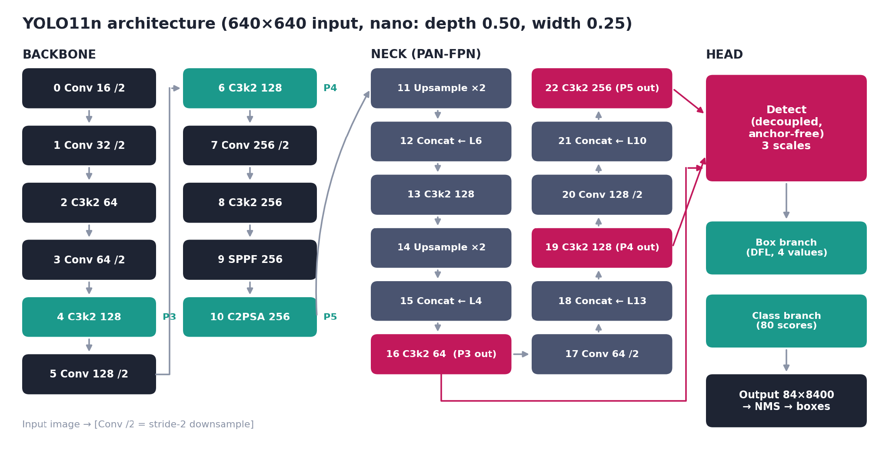
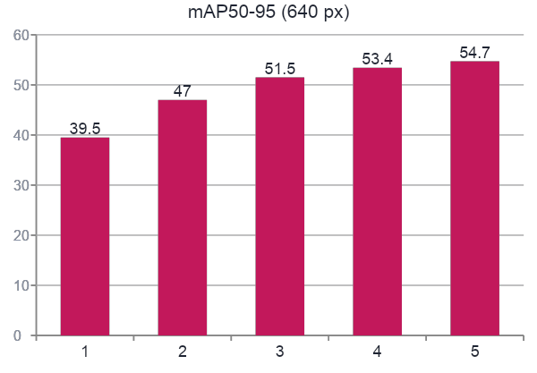
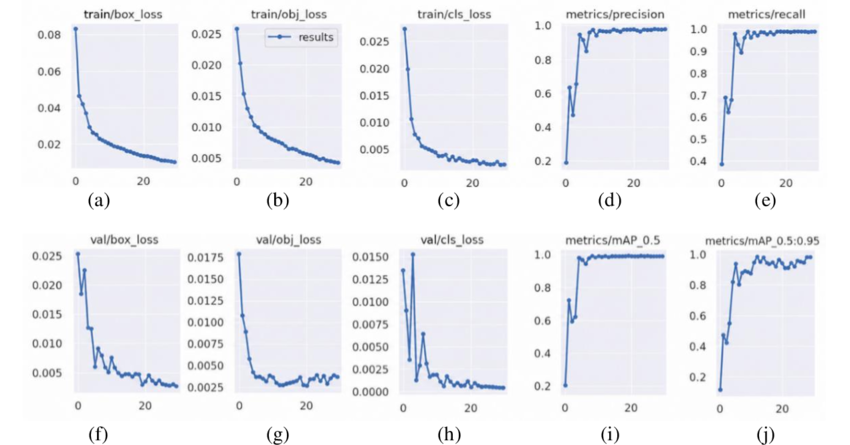
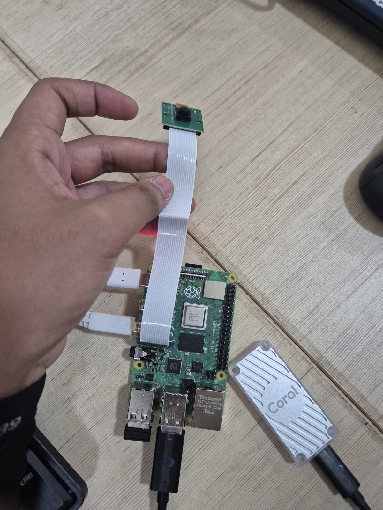
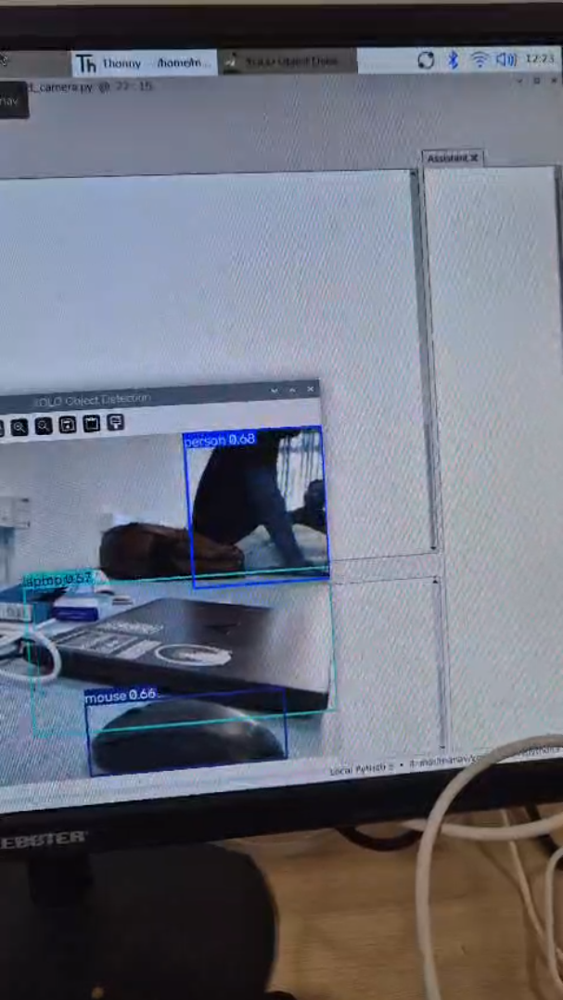

# Real-Time Object Detection Using YOLO11n on Raspberry Pi 4

**Raspberry Pi Camera Module 3 (Rev 1.3) | YOLO11n | NCNN | Edge AI**

## Overview

This project demonstrates real-time object detection on a **Raspberry Pi 4**, using the **Pi Camera Module 3** and a pretrained **YOLO11n** model exported to **NCNN** format. A Python script run in **Thonny IDE** captures live camera frames, performs local inference, and displays annotated detections on a monitor. The model recognizes the **80 COCO classes** supported by the pretrained detector.

## Problem Statement

Running object detection on small, low-cost devices is challenging because inference requires significant computation. This project demonstrates an offline, local camera-to-detection workflow without sending camera footage to a cloud service, while acknowledging practical limitations such as low CPU FPS, low-light blur, occlusion, and autofocus instability.

## Features

- Live video capture using Pi Camera Module 3 and Picamera2.
- YOLO11n object detection using an exported NCNN model.
- Object labels, confidence scores, bounding boxes, and FPS display (as described in the presentation).
- Confidence filtering and non-maximum suppression (NMS).
- Local, offline edge inference on Raspberry Pi 4.
- Stop the detection loop by pressing **Q**.

## Tech Stack

| Category | Technology / hardware |
|---|---|
| Board | Raspberry Pi 4 (quad-core CPU) |
| Camera | Pi Camera Module 3 (Rev 1.3), Sony IMX708, 12 MP, autofocus, HDR, CSI connection |
| Operating system | Raspberry Pi OS |
| Language and IDE | Python, Thonny |
| Camera interface | Picamera2 / libcamera |
| Object detection | Ultralytics YOLO11n |
| Model format | NCNN |
| Image display | OpenCV |
| Hardware shown in demo | Raspberry Pi, camera, monitor, and Coral USB Accelerator |

> The report shows a Coral USB Accelerator in the hardware setup, but does not establish that it was used to accelerate the NCNN inference pipeline.

## System Architecture

```text
Pi Camera Module 3
       |
       v
Picamera2 frame capture (RGB888, 640x480 in report example)
       |
       v
Preprocessing (model input 640x640)
       |
       v
YOLO11n NCNN model
  | Backbone: Conv -> C3k2 -> SPPF -> C2PSA
  | Neck: top-down and bottom-up PAN-FPN fusion
  | Head: anchor-free detection at P3, P4, P5
       |
       v
Confidence filtering + NMS
       |
       v
Bounding boxes + labels + confidence + FPS
       |
       v
Live display on monitor (press Q to quit)
```



## Installation

1. Install Raspberry Pi OS and connect the Pi Camera Module 3 to the Raspberry Pi 4 CSI port. Use a suitable 5 V / 3 A USB-C supply.
2. Copy the **two project files** to the Raspberry Pi: `yolo11_ncnn_model.zip` and your Python detection script.
3. Extract the archive so the model directory can be accessed by the script:

   ```bash
   mkdir -p models
   unzip yolo11_ncnn_model.zip -d models/
   ```

4. Install the camera and display dependencies if they are not already available:

   ```bash
   sudo apt update
   sudo apt install python3-picamera2 python3-opencv
   ```

5. Configure an appropriate Python environment for Ultralytics and NCNN, then install the dependencies required by **your actual script**. The presentation includes `pip install ultralytics` but does not specify a complete, tested dependency list or Python environment.
6. Open the detection script in **Thonny IDE**. Ensure its model path matches the extracted model folder (the report example uses `yolo11n_ncnn_model`; the supplied archive is named `yolo11_ncnn_model.zip`).

> The actual Python script was not supplied with the presentation, so exact installation commands and file paths must be checked against it before treating this as a fully reproducible setup.

## Usage

1. Connect and verify the camera.
2. Extract the NCNN model archive.
3. Open the Python script in Thonny on the Raspberry Pi.
4. Run it using Thonny's **Run** button.
5. View live detections on the connected monitor.
6. Press **Q** to end the loop.

The presentation demonstrates the following essential code pattern:

```python
from picamera2 import Picamera2
from ultralytics import YOLO
import cv2

model = YOLO("yolo11n_ncnn_model")
cam = Picamera2()
cam.configure(cam.create_preview_configuration(
    main={"format": "RGB888", "size": (640, 480)}
))
cam.start()

while True:
    out = model(cam.capture_array())[0].plot()
    cv2.imshow("YOLO11n", out)
    if cv2.waitKey(1) == ord("q"):
        break
```

*This is the example shown in the report, not a claim that it is identical to the full project script.*

## Project Structure

```text
YOLO11n-Raspberry-Pi-Object-Detection/
│
├── README.md
├── architecture.png
├── detection_demo.png
├── hardware_setup.jpg
├── loss_graph.png
├── model_comparison.png
├── objectdetection.py
└── yolo11n_ncnn_model.zip
```

## Dataset and Models

The report describes **pretrained YOLO11n**, supporting **80 COCO object classes**, deployed in **NCNN** format. It does **not** document a custom training dataset or a separate fine-tuning run for this Raspberry Pi deployment.

| Model detail | Value in presentation |
|---|---|
| Model | YOLO11n (Nano) |
| Parameters | 2.6 million |
| Compute | 6.5 GFLOPs at 640 × 640 |
| Classes | 80 COCO classes |
| Detection scales | P3: 80×80, P4: 40×40, P5: 20×20 |
| Candidate points | 8,400 (6,400 + 1,600 + 400) |
| Output before postprocessing | 84 × 8,400 (4 box values + 80 class scores) |
| Deployment | NCNN on Raspberry Pi 4 |

## Results

### Published YOLO11n COCO reference metrics (reported in the presentation)

| Evaluation measure | Value |
|---|---:|
| mAP50–95 | **39.5%** |
| mAP50 | **51.5%** |
| Precision | **65.6%** |
| Recall | **50.2%** |
| ROC/AUC | **> 0.94**, as stated in the presentation |

**Interpretation:** These are presented as COCO/reference evaluation figures, **not metrics measured on the Raspberry Pi deployment or a custom dataset**. The report also explains that ROC/AUC is not a standard headline metric for object detection because true negatives are not naturally defined across background regions. Precision–Recall curves, AP, and mAP are more appropriate. The reported AUC value has no documented independent validation procedure in the presentation.

**Definitions:** Precision = TP / (TP + FP); Recall = TP / (TP + FN); IoU = intersection / union; AP is the area under a class Precision–Recall curve; mAP averages AP over classes. mAP50 uses IoU 0.50, while mAP50–95 averages thresholds from 0.50 to 0.95.

### Raspberry Pi observations

The presentation reports working live detections, but **does not provide measured average FPS, inference latency, CPU utilization, or RAM usage**. It identifies low FPS on the Raspberry Pi 4 CPU, blurry/dark frames, missed small or partially hidden objects, and autofocus hunting during motion as challenges.

### Figures from the report

**YOLO11 variant comparison**



**Loss graphs included in the presentation**



*The presentation does not establish these loss graphs as a training run performed for this Raspberry Pi deployment.*

## Screenshots / Demo

**Hardware setup from the presentation**



**Live object detection demonstration image from the presentation**



The presentation also references a demo recording playable in slideshow mode. A standalone video link is not provided here.

## Future Scope

The report identifies these next steps:

- Explore **INT8 quantization** for higher FPS.
- Train the detector on **custom classes**.
- Add **alerts and object counting**.
- Measure **precision, recall, and mAP on the project's own dataset**.

## Contributors

| Contributor | Roll number |
|---|---|
| Aryaman Pradhan | UCSE23012 |
| Chelsea Nayak | UCSE23014 |
| Deepak Sai Mohapatra | UCSE23018 |
| Rhea Bachheti | UCSE23070 |
| Anirudha Dash | UCSE23007 |

---

